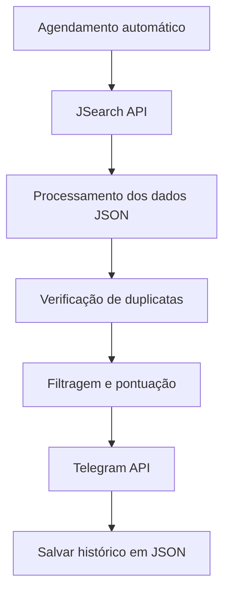

# JobRadar

Projeto desenvolvido para a disciplina de Automação e Programabilidade em Redes.

## 1. Sobre o projeto

O JobRadar é uma automação desenvolvida em Python que busca vagas de emprego na área de tecnologia, analisa sua compatibilidade com o perfil do usuário e envia as melhores oportunidades pelo Telegram.

O objetivo é automatizar a busca por empregos, reduzindo o tempo gasto em pesquisas manuais e evitando o envio de vagas repetidas.

## 2. Arquitetura e funcionamento

A aplicação realiza buscas automaticamente a cada 12 horas, seguindo o fluxo abaixo:



### Critérios de compatibilidade

| Critério | Pontuação máxima |
|---|---:|
| Tecnologias compatíveis | 50 pontos |
| Senioridade | 30 pontos |
| Localização | 20 pontos |
| **Total** | **100 pontos** |

Vagas com pontuação igual ou superior a 50 são selecionadas, respeitando os filtros de senioridade e localização.

O sistema armazena os identificadores das vagas enviadas em um arquivo JSON para evitar notificações duplicadas.

## 3. Tecnologias utilizadas

- Python
- Requests
- Python-dotenv
- Schedule
- JSON
- JSearch API (RapidAPI)
- Telegram Bot API
- HTTP/HTTPS
- Git e GitHub

## 4. Como executar

### Pré-requisitos

- Python instalado
- Conta no RapidAPI com acesso à JSearch
- Bot criado no Telegram através do BotFather

### Instalação

Clone o repositório:

```bash
git clone https://github.com/SEU_USUARIO/JobRadar.git
cd JobRadar
```

Crie e ative o ambiente virtual:

```powershell
python -m venv venv
.\venv\Scripts\Activate.ps1
```

Instale as dependências:

```bash
pip install -r requirements.txt
```

Crie o arquivo `.env` com base no `.env.example` e configure as credenciais:

```env
RAPIDAPI_KEY=sua_chave
RAPIDAPI_HOST=jsearch.p.rapidapi.com
TELEGRAM_BOT_TOKEN=seu_token
TELEGRAM_CHAT_ID=seu_chat_id
```

Execute a aplicação:

```bash
python main.py
```

A primeira busca será realizada imediatamente. As próximas serão executadas automaticamente a cada 6 horas, enquanto a aplicação estiver em funcionamento.

Para encerrar, pressione `Ctrl + C`.

## 5. Demonstração

Exemplo de notificação enviada pelo JobRadar:


Exemplo de execução da automação:


## 6. Melhorias futuras

- Integração com outras APIs de vagas de emprego.
- Utilização de inteligência artificial para melhorar a análise de compatibilidade.
- Hospedagem em nuvem para funcionamento contínuo.

---

Desenvolvido por Octávio Germano Hellwig e João Robe.

Análise e Desenvolvimento de Sistemas — UniSenac.

Disciplina: Automação e Programabilidade em Redes.
